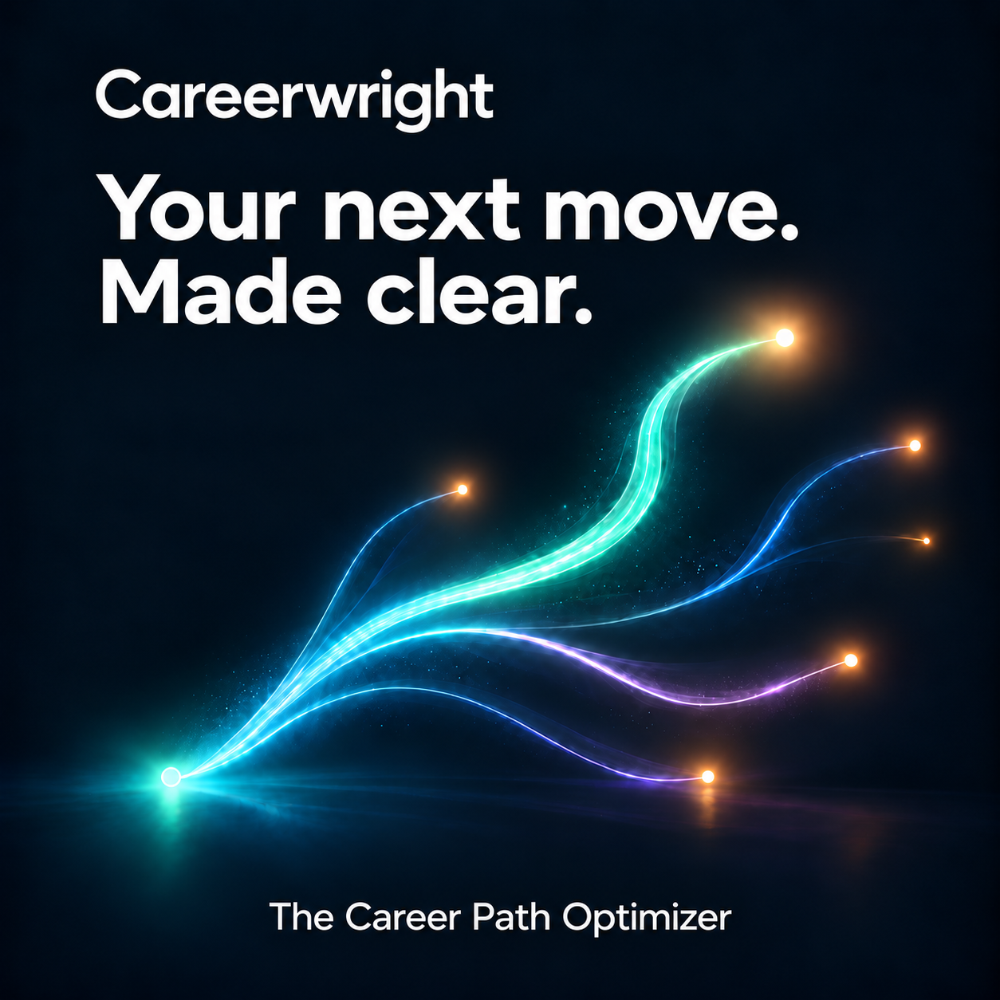
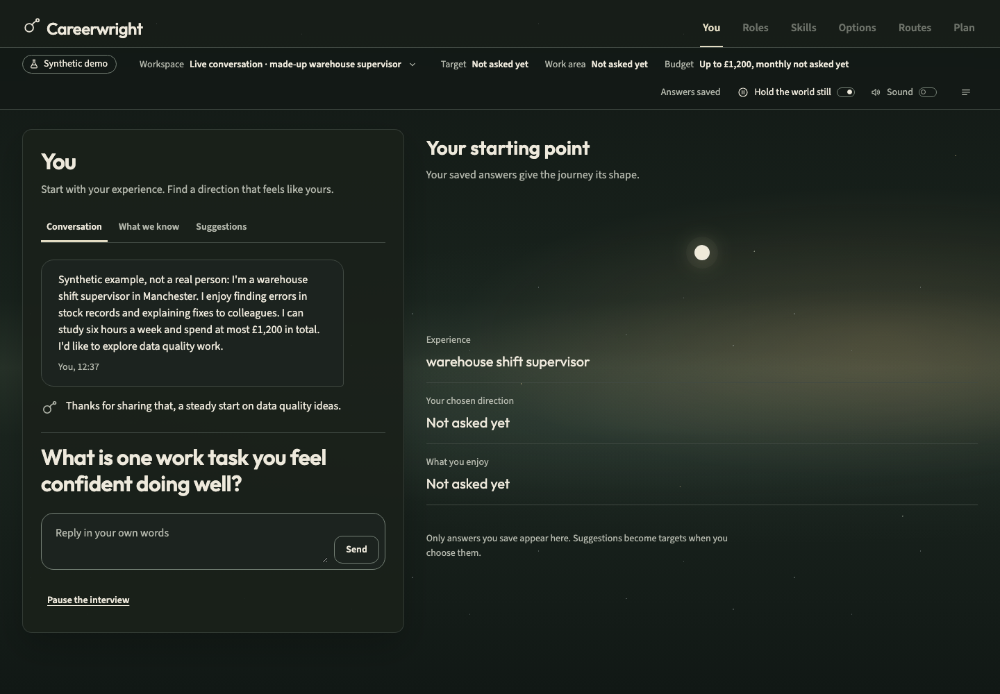
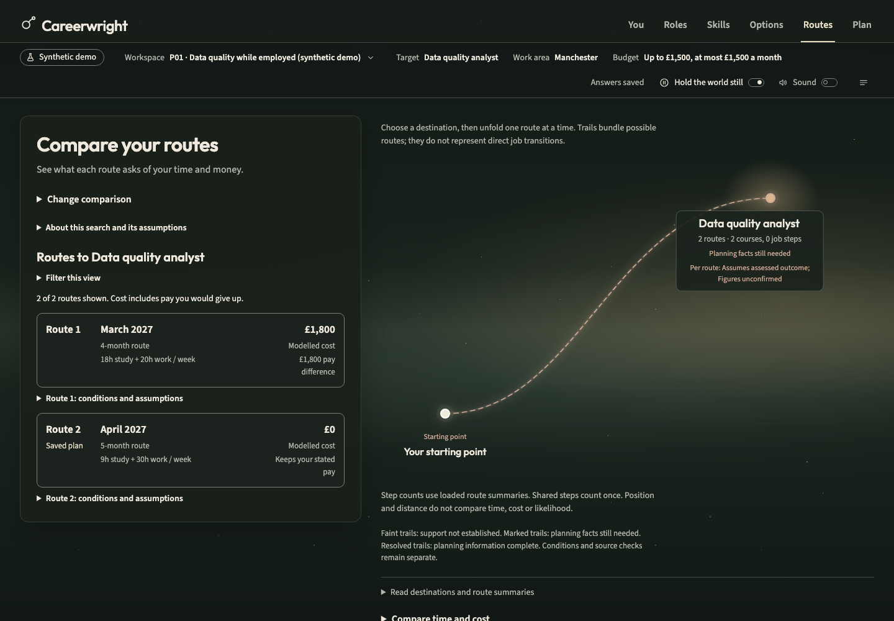
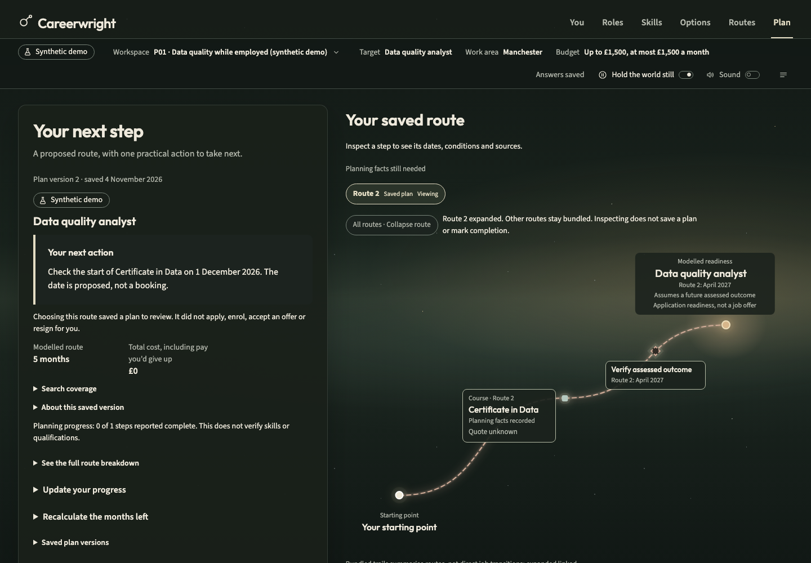

# Careerwright

Changing careers means piecing together job requirements, training and funding
from scattered sources, while working out what you can afford and fit around your
life. Careerwright is a career path optimiser that brings those pieces together.
It uses your experience, goals, budget and available time to compare routes into
a new role, showing the costs, time, trade-offs and missing information so you can
choose a practical next step.

The current version runs locally and focuses on career and training options in
England. It includes a synthetic demo so you can try the whole journey without an
API key.

## What it does

The app has six chapters:

- **You:** talk through your situation, review suggested answers and decide what to save.
- **Roles:** explore career directions and inspect the sources behind them.
- **Skills:** compare your experience with a role's requirements and record supporting evidence.
- **Options:** research courses and funding, add your own options and fill in missing details.
- **Routes:** compare possible sequences of work and training against your time and money limits.
- **Plan:** save a route, track progress and export it, including a calendar file.

AI helps with conversation, suggestions and research. Application code calculates
readiness, costs, feasibility and route rankings. Missing information stays visible;
a route that depends on unchecked information keeps that qualification. Results
cover the available catalogue and planning assumptions, not every possible career
path or a promise of a job.

## Run locally

You need Docker with Compose v2 running, [uv](https://docs.astral.sh/uv/),
Node.js 24 and pnpm **10.33.2**. Setup installs Python 3.12 through uv, locked
dependencies and Playwright's Chromium, downloads the pinned reference datasets,
and builds the Docker images. The first setup needs internet access.

From the repository root:

```sh
make setup
make demo
```

Open **http://127.0.0.1:53000** and sign in with the seeded demo account:

- Email: `ada@careerwright.test`
- Password: `careerwright-demo-ada`

Open **P01 · Data quality while employed (synthetic demo)** to work through an
example, or create a demo workspace. Demo mode uses deterministic fixture responses and has no outbound
internet access. Its people, course figures and examples are synthetic.

```sh
make stop        # Stop services; keep your data.
make demo        # Start them again.
make reset-demo  # Reset all five P01–P05 fixture workspaces; keep other workspaces.
```

Local keys and configuration live in `~/.careerwright/l0` by default; workspace
data lives in Docker volumes. `CAREERWRIGHT_HOME` changes the configuration location.

### Live conversation and research

Run `make dev`, create a live-assisted workspace, and add your Meta Model API key
through the app's key setup. The app asks for consent before storing it encrypted.
Live calls use the workspace's spending limits; the offline demo does not make
model calls.

The default live model is `muse-spark-1.3`. `make session` starts the same local
stack with `muse-wonder-1.0` for workspaces that are not marked synthetic, with its
own spending limits. Synthetic live workspaces use
`muse-spark-1.3-contributor`; Contributor mode may use prompts for training, so
keep those inputs synthetic or public.

For command-line live checks, create an untracked `.env` from `.env.example` and
set `META_API_KEY`. Optional Adzuna credentials enable live vacancy search. See the
[runbook](docs/runbook.md) for configuration, spending limits and troubleshooting.

## Screenshots

These captures use fictional people and prepared demo data. The conversation shows
a saved real Muse Spark response to synthetic input; the route comparison and plan
show the app's calculations on prepared inputs, not newly researched live results.

**You:** review a conversation and the answers you have chosen to keep.



**Routes:** compare time, spending and the conditions attached to each route.



**Plan:** see the steps in your chosen route and track progress.



## Tools used

The web app uses Next.js, React, TypeScript and Three.js. The Python backend uses
FastAPI, Pydantic AI, DBOS and PostgreSQL 16. Docker Compose runs the local services,
including a Firebase Auth emulator.

| Tool | Use in this project |
|---|---|
| Muse Code | AI coding assistance during development. |
| Muse LLMs: Spark and Wonder | Chat, career suggestions, internet research through Meta's web search, and structured completions for profile proposals and extraction from sources. Spark is the default; Wonder is supported for configured live sessions. |
| Scrapling | Web scraping and HTML parsing to extract structured page data. Careerwright's guarded HTTP client fetches pages; Scrapling parses them, including job postings and course or funding information. |
| Claude Code | Coding assistance for implementation, testing and debugging. |
| Codex | Coding assistance for implementation, review, testing and repository maintenance. |
| ElevenLabs | Narration for the product demonstration. |
| HyperFrames | Composing and rendering the demonstration video. |
| Playwright | Browser journeys, keyboard and layout checks, and screenshots of the running app. |

## Describe your use of Meta products to build the submitted project

We used Muse Code during development and integrated Muse Spark and Muse Wonder
through the Meta Model API. In the app, Muse asks follow-up questions, proposes
profile updates, suggests career directions and explains possible matches. Meta's
web search helps find sources for role, course and funding research. Structured
completions turn conversation and source text into typed proposals that the app
can validate. Quoted passages are checked against their sources, and people review
proposed profile changes before saving them.

Spark is the default live model, with its Contributor variant used only for
synthetic or public inputs. Wonder is available for configured live sessions.
Both sit behind the same validation and spending controls. The route solver itself
uses deterministic code.

## Why are Meta's models important to your solution?

Career planning starts with incomplete, everyday descriptions of someone's work,
interests and constraints. Muse connects those descriptions to information the
planner can use: it asks useful follow-ups, proposes structured answers and helps
find relevant evidence across scattered websites. This reduces how much someone
has to know before they can start exploring a change.

The combination of conversation, web search and structured output makes that
workflow practical. The app can check the resulting proposals and let the person
correct them, while its own calculations keep route comparisons consistent and
show where information is still missing.

## Development

```sh
make check       # Formatting, lint, types, unit tests and generated API checks.
make acceptance  # Database, worker and browser tests on isolated Docker stacks.
```

Both commands avoid paid model calls. Acceptance also builds Storybook and checks
the browser journeys. For component work, run `pnpm storybook` from `apps/web`.
After changing the API, run `pnpm run generate` there and commit the generated client.

- `apps/web/`: web app, components, Storybook stories and browser tests.
- `backend/`: API, workers, career-planning logic, migrations and Python tests.
- `fixtures/` and `corpus/`: test fixtures and the source-corpus manifest.
- `docker/` and `compose*.yaml`: local service configuration.
- `docs/`: [product specification](docs/Careerwright_Product_Specification.md),
  [runbook](docs/runbook.md), design references and README images.
- `spikes/`: standalone experiments outside the application.

Licensed under [Apache 2.0](LICENSE).
